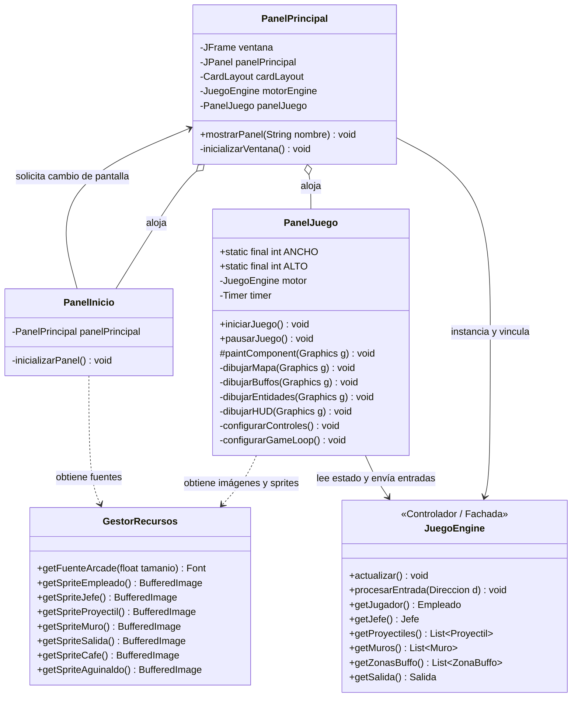
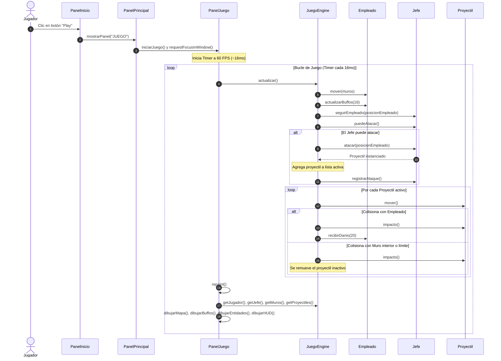

# Escape Corporativo: La Fuga del Empleado

**Trabajo Práctico Obligatorio — Paradigma Orientado a Objetos (POO)**  
*Universidad Argentina de la Empresa (UADE) — Facultad de Ingeniería y Ciencias Exactas*

---

## Información General

| Campo | Detalle |
|---|---|
| **Materia** | Paradigma Orientado a Objetos (3.4.208) |
| **Carrera** | Ingeniería en Informática / Gestión de TI |
| **Profesor** | Hernandez, Pablo Eduardo |
| **Período** | 2do Cuatrimestre 2026 |
| **Equipo** | El One Piece (Grupo 1) |
| **Repositorio** | [El-One-Piece-POO](https://github.com/EspondaEmiliano/El-One-Piece-POO) |

### Integrantes

- **Alcaide, Yamil**
- **Esponda, Emiliano**
- **Miguez, Ian Franco**
- **Torres, Matías**
- **Villavedra, Santiago Martín**

---

## Descripción del Juego

**Escape Corporativo: La Fuga del Empleado** es una propuesta de videojuego 2D de acción y estrategia en tiempo real desarrollado en **Java**.

### Premisa Narrativa
El jugador encarna a un empleado exhausto atrapado en un ambiente corporativo opresivo. Su misión principal es escapar de la oficina antes de que venza su horario laboral reglamentario. Durante su huida, deberá evadir incansablemente a su **Jefe**, un antagonista impulsado por IA que intentará adjudicarle horas extra arrojándole proyectiles cargados de tareas y trabajo pendiente (palas).

### Objetivo
Guiar al **Empleado** desde su punto de inicio/escritorio (Punto B) hasta la **Salida Principal** de la corporación (Punto A / Meta) a través de un laberinto de cubículos y pasillos, esquivando proyectiles, recolectando ítems de mejora (*buffos*) y gestionando el tiempo restante.

#### Condiciones de Victoria
- **Salida alcanzada:** El jugador llega a las coordenadas de la Salida Principal antes de que finalice la jornada laboral (tiempo límite).
- **Ítems requeridos:** En niveles avanzados, haber recolectado los ítems clave de salida solicitados (por ejemplo, *Tarjeta de Acceso*).

#### Condiciones de Derrota
- **Impacto o captura:** Un proyectil impacta contra el Empleado o este entra en contacto directo con el Jefe, provocando la pérdida del intento y el reinicio de la posición al inicio del mapa.
- **Tiempo agotado:** Finalizar la jornada laboral sin haber alcanzado la meta.

---

## Reglas de Jugabilidad y Mecánicas

El diseño y la lógica de juego se articulan sobre tres reglas de negocio centrales:

1. **Movimiento y Colisiones (Motor de Física 2D):**
   - El Empleado se desplaza en 4 direcciones cardinales (Arriba, Abajo, Izquierda, Derecha) mediante controles de teclado.
   - En cada ciclo del *Game Loop*, la posición intentada es evaluada mediante la intersección de sus cajas envolventes (*Bounding Boxes* / `java.awt.Rectangle`).
   - Los **Muros** y cubículos son infranqueables: anulan el movimiento del Empleado y del Jefe, y destruyen o frenan proyectiles al colisionar.
   - El impacto de un proyectil gatilla eventos de daño o reinicio mediante el manejo de excepciones de colisión (`ImpactoProyectilException`).

2. **Sistema Polimórfico de Buffos:**
   - Distribuidos por el mapa existen sectores especiales denominados **Zonas de Buffo** (`ZonaBuffo`).
   - Todos los buffos heredan o implementan el contrato `Buffo`, disponiendo de un temporizador de duración.
   - **Café (`Cafe`):** Otorga un incremento temporal en la velocidad de desplazamiento del Empleado.
   - **Aguinaldo (`Aguinaldo`):** Proporciona vidas extra o resistencia momentánea frente al impacto de proyectiles.
   - El sistema respeta el principio *Open/Closed* (OCP), permitiendo añadir nuevas bonificaciones sin modificar la lógica central del motor.

3. **Progresión y Persistencia:**
   - Superación secuencial de niveles con dificultad creciente en el diseño del laberinto y la agresividad del Jefe.
   - El progreso y la tabla de mejores registros (*High Scores* / Ranking) se serializan y almacenan en disco mediante servicios dedicados (`GestorArchivos`).

---

## Actores y Entidades del Sistema

| Entidad | Rol | Comportamiento en la Simulación |
|---|---|---|
| **`Empleado`** | Personaje Principal (Avatar) | Desplazado por el jugador vía teclado en cuatro direcciones. Detecta colisiones con muros, proyectiles y zonas de buffo. |
| **`Jefe`** | Antagonista / IA | Persigue dinámicamente al Empleado evaluando su posición; alterna entre modos de patrullaje y persecución activa, y arroja proyectiles. |
| **`Proyectil`** | Obstáculo Móvil (Pala / Tarea) | Objeto lanzado por el Jefe hacia la ubicación del Empleado. Al impactar, descuenta vida o causa la pérdida del intento. |
| **`Muro`** | Obstáculo Rígido Estático | Estructura rígida e infranqueable que bloquea el paso de entidades móviles y destruye proyectiles al contacto. |
| **`Salida`** | Punto de Control / Meta | Marca la coordenada de escape y actúa como disparador de victoria al activarse por colisión. |
| **`ZonaBuffo`** | Sector de Bonificación | Casilla interactiva que otorga al Empleado un buffo de tipo `Cafe` o `Aguinaldo` al ser atravesada. |

---

## Arquitectura del Proyecto y Estructura en Código

El proyecto sigue una arquitectura desacoplada basada en el patrón **MVC (Modelo-Vista-Controlador)** y principios de diseño limpio. La implementación se encuentra estructurada en el paquete raíz [`src/TpoEscapeCorporativo`](../src/TpoEscapeCorporativo/):

```
src/TpoEscapeCorporativo/
├── controlador/
│   └── JuegoEngine.java               # Motor principal: orquesta el Game Loop, eventos y actualización
├── excepciones/
│   ├── ImpactoProyectilException.java # Excepción lanzada al colisionar un proyectil contra el Empleado
│   └── NivelNoEncontradoException.java # Excepción checked ante ausencia o fallo de lectura del mapa de nivel 
├── interfaces/
│   ├── Buffo.java                     # Contrato polimórfico para los potenciadores temporales
│   └── IColisionable.java             # Contrato para entidades sujetas a detección de colisiones
├── modelo/
│   ├── datos/
│   │   ├── Direccion.java             # Enum con las orientaciones de movimiento (ARRIBA, ABAJO, etc.)
│   │   ├── Posicion.java              # Coordenadas (x, y) en el espacio bidimensional
│   │   └── Puntaje.java               # Modelo de puntuación, tiempos y métricas de desempeño
│   ├── entidades/
│   │   ├── EntidadEstatica.java       # Clase abstracta base para obstáculos y triggers fijos
│   │   ├── EntidadMovil.java          # Clase abstracta base para actores con desplazamiento autónomo o manual
│   │   ├── Empleado.java              # Avatar controlable del jugador
│   │   ├── Jefe.java                  # Antagonista impulsado por IA
│   │   ├── Muro.java                  # Obstáculo rígido e intransitable del laberinto
│   │   ├── Proyectil.java             # Proyectil balístico lanzado por el Jefe
│   │   └── Salida.java                # Punto de meta y disparador de victoria
│   └── items/
│       ├── Aguinaldo.java             # Modificador que otorga vidas o resistencia
│       ├── Cafe.java                  # Modificador que incrementa la velocidad de desplazamiento
│       └── ZonaBuffo.java             # Entidad estática que contiene y entrega un Buffo
├── servicios/
│   └── GestorArchivos.java            # Persistencia de ranking (serialización) y carga de matrices de nivel (.txt)
└── vista/
    ├── GestorRecursos.java            # Carga y escalado de fuentes arcade y sprites/animaciones pixel art
    ├── PanelInicio.java               # Pantalla de bienvenida con título, botón Play y redimensionamiento dinámico
    ├── PanelJuego.java                # Canvas principal con Game Loop (Timer), renderizado y captura de teclado
    └── PanelPrincipal.java            # Contenedor JFrame con CardLayout para alternar entre inicio y juego activo
```

---

## Diagramas de Arquitectura y Clases UML

Para garantizar una separación rigurosa de responsabilidades acorde al patrón **MVC** y facilitar la lectura técnica, el modelado estático del sistema se organiza en dos diagramas complementarios:
1. **Dominio y Motor:** Modela las jerarquías de herencia, entidades, interfaces polimórficas, persistencia y el motor central (`JuegoEngine`).
2. **Interfaz de Usuario (Vista):** Modela las ventanas y paneles Swing, el gestor de recursos y su comunicación con `JuegoEngine`.

---

### 1. Diagrama de Clases: Dominio y Motor (Modelo y Controlador)

```mermaid
classDiagram
    %% Interfaces
    class IColisionable {
        <<interface>>
        +verificarColision(IColisionable otro) boolean
    }
    class Buffo {
        <<interface>>
        +aplicar(Empleado empleado) void
        +actualizarTiempo(int deltaMs) void
        +estaActivo() boolean
        +getNombre() String
    }

    %% Jerarquía de Entidades Base
    class EntidadMovil {
        <<abstract>>
        #Posicion posicion
        #int velocidad
        #Direccion direccionActual
        +mover() void
        +getPosicion() Posicion
        +getVelocidad() int
        +setVelocidad(int velocidad) void
        +getDireccionActual() Direccion
        +setDireccionActual(Direccion direccionActual) void
    }
    class EntidadEstatica {
        <<abstract>>
        #Posicion posicion
        +getPosicion() Posicion
    }

    %% Implementaciones de Entidades Móviles
    class Empleado {
        -int salud
        -List~Buffo~ buffosActivos
        +mover(List~Muro~ muros) void
        +recibirDanio(int danio) void
        +agregarBuffo(Buffo buffo) void
        +actualizarBuffos(int deltaMs) void
        +getSalud() int
        +getBuffosActivos() List~Buffo~
    }
    class Jefe {
        -String nombre
        -int tiempoEntreAtaques
        -long ultimoAtaqueTiempo
        -Proyectil proyectilGenerado
        +seguirEmpleado(Posicion posicionEmpleado) void
        +puedeAtacar() boolean
        +atacar(Posicion posicionEmpleado) void
        +registrarAtaque() void
        +getProyectilGenerado() Proyectil
        +limpiarProyectilGenerado() void
    }
    class Proyectil {
        -int dx
        -int dy
        -boolean estaActivo
        +mover() void
        +impacto() void
        +getEstaActivo() boolean
    }

    %% Implementaciones de Entidades Estáticas
    class Muro {
        +verificarColision(Posicion otraPosicion) boolean
    }
    class Salida {
        +esAlcanzada(Posicion posicionJugador) Boolean
    }
    class ZonaBuffo {
        -Buffo buffo
        -boolean recolectado
        +verificarColision(Posicion otraPosicion) boolean
        +consumirBuffo() Buffo
        +isRecolectado() boolean
        +getBuffo() Buffo
    }

    %% Implementaciones de Buffos
    class Cafe {
        -int tiempoRestanteMs
        -int incrementoVelocidad
        +aplicar(Empleado empleado) void
        +actualizarTiempo(int deltaMs) void
        +estaActivo() boolean
        +getNombre() String
    }
    class Aguinaldo {
        -int saludRecuperada
        -int puntosExtra
        -boolean aplicado
        +aplicar(Empleado empleado) void
        +actualizarTiempo(int deltaMs) void
        +estaActivo() boolean
        +getNombre() String
    }

    %% Clases de Soporte / Datos
    class Posicion {
        -int x1
        -int y1
        -int x2
        -int y2
        +getX1() int
        +getY1() int
        +getX2() int
        +getY2() int
        +setX1(int x1) void
        +setY1(int y1) void
        +setX2(int x2) void
        +setY2(int y2) void
    }
    class Direccion {
        <<enumeration>>
        ARRIBA
        ABAJO
        IZQUIERDA
        DERECHA
        NINGUNA
        +getDx() int
        +getDy() int
    }
    class Puntaje {
        -String nombreJugador
        -int puntos
        -long tiempoSegundos
        -LocalDateTime fechaRegistro
        +getNombreJugador() String
        +getPuntos() int
        +getTiempoSegundos() long
        +getTiempoFormateado() String
        +compareTo(Puntaje nuevoPuntaje) int 
    }

    %% Controlador Principal
    class JuegoEngine {
        -List~Muro~ muros
        -List~Proyectil~ proyectiles
        -List~ZonaBuffo~ zonaBuffos
        -Empleado jugador
        -Jefe enemigo
        -Salida salida
        +actualizar() void
        +procesarEntrada(Direccion nuevaDireccion) void
        +cargarNivel(int numeroNivel) void
        +getJugador() Empleado
        +getJefe() Jefe
        +getProyectiles() List~Proyectil~
        +getZonasBuffo() List~ZonaBuffo~
        +getMuros() List~Muro~
        +getSalida() Salida
    }
    class GestorArchivos {
        -String rutaRanking
        -String carpetaNiveles
        +guardarPuntaje(Puntaje nuevoPuntaje) void
        +cargarMejoresPuntajes() List~Puntaje~
        +cargarMapaNivel(int numeroNivel) char[][]
        +getRutaRanking() String
        +getCarpetaNiveles() String
    }
    class ImpactoProyectilException {
        +ImpactoProyectilException(String mensaje)
    }
    class NivelNoEncontradoException {
        +NivelNoEncontradoException(String mensaje)
        +NivelNoEncontradoException(String mensaje, Throwable causa)
    }

    %% Relaciones de Implementación y Herencia
    EntidadMovil ..|> IColisionable
    EntidadEstatica ..|> IColisionable

    Empleado --|> EntidadMovil
    Jefe --|> EntidadMovil
    Proyectil --|> EntidadMovil

    Muro --|> EntidadEstatica
    Salida --|> EntidadEstatica
    ZonaBuffo --|> EntidadEstatica

    Cafe ..|> Buffo
    Aguinaldo ..|> Buffo
    ZonaBuffo o-- Buffo : administra

    %% Asociaciones de Datos y Composición
    EntidadMovil *-- Posicion
    EntidadEstatica *-- Posicion
    EntidadMovil --> Direccion

    %% Orquestación Modelo-Controlador
    JuegoEngine --> Empleado : gestiona
    JuegoEngine --> Jefe : gestiona
    JuegoEngine --> Salida : gestiona
    JuegoEngine o-- Muro : contiene
    JuegoEngine o-- Proyectil : contiene
    JuegoEngine o-- ZonaBuffo : contiene
    JuegoEngine ..> ImpactoProyectilException : atrapa/lanza
    JuegoEngine --> GestorArchivos : persiste y carga niveles

    %% Persistencia y Excepciones
    Puntaje ..|> Comparable
    Puntaje ..|> Serializable
    GestorArchivos ..> NivelNoEncontradoException : lanza
    GestorArchivos ..> Puntaje : serializa/recupera
```



---

### 2. Diagrama de Clases: Interfaz de Usuario (Vista - Swing)



---

## Diagrama de Secuencia: Ciclo de Juego (Game Loop) y Colisiones

El siguiente diagrama detalla la interacción dinámica y temporal entre los componentes de la Vista (Swing), el Controlador (`JuegoEngine`) y las entidades del Modelo durante el arranque y la ejecución en tiempo real:



---

## Decisiones de Diseño y Pilares de POO

El sistema modela fielmente las exigencias académicas de la materia mediante la aplicación rigurosa de los paradigmas de orientación a objetos:

| Pilar / Principio | Aplicación en el Proyecto | Justificación Técnica |
|---|---|---|
| **Abstracción** | Jerarquías de `EntidadMovil` y `EntidadEstatica` que generalizan el posicionamiento euclidiano y las dimensiones en pantalla. | Evita código duplicado y proporciona una base extensible para cualquier nuevo elemento gráfico interactivo. |
| **Herencia** | `Empleado`, `Jefe` y `Proyectil` heredan atributos cinemáticos de `EntidadMovil`; `Muro`, `Salida` y `ZonaBuffo` derivan de `EntidadEstatica`. | Modela coherentemente las relaciones de especialización (*es-un*) en el dominio. |
| **Polimorfismo** | Uso unificado de la interfaz `Buffo` (`Cafe` y `Aguinaldo`) e iteración polimórfica sobre colecciones `List<IColisionable>`. | Permite añadir nuevas mejoras y entidades sin modificar el evaluador de física ni el motor central (**Principio Abierto/Cerrado - OCP**). |
| **Encapsulamiento** | Atributos privados con métodos accesores validados en clases de estado (`Posicion`, `Puntaje`, entidades). | Protege la integridad de los datos impidiendo coordenadas o estados incongruentes. |
| **Interfaces** | Contratos funcionales `IColisionable` y `Buffo` para desacoplar comportamiento de estructura interna. | Fomenta bajo acoplamiento y alta cohesión (**GRASP / SOLID**). |
| **Manejo de Excepciones** | Distinción formal entre excepciones *checked* (`NivelNoEncontradoException` para I/O y carga de niveles) y *unchecked* (`ImpactoProyectilException` para eventos dinámicos de colisión). | Obliga a un tratamiento controlado y robusto de fallos de persistencia en disco, separando errores de infraestructura de la física en tiempo real. |

---

## Concurrencia y Aspectos Técnicos

- **Bucle Principal Multihilo (Game Loop):**  
  Implementado mediante un temporizador asíncrono Swing (`javax.swing.Timer` a 60 FPS / ~16ms) en `PanelJuego`, que desacopla la lógica de actualización en `JuegoEngine.actualizar()` del repintado gráfico periódico.
- **Prevención de Parpadeo (Double Buffering):**  
  Mecanismo nativo provisto por Java Swing y `JPanel` que realiza el renderizado en un búfer de memoria antes de transferirlo al canvas visible.
- **Persistencia de Datos:**  
  Administrada por `GestorArchivos` para garantizar el almacenamiento duradero del Top 10 del ranking mediante serialización binaria (`Serializable`) y la carga dinámica de mapas matriciales desde archivos de texto plano (.txt).

---

## Alcance y Plan de Trabajo

| Hito | Contenido Previsto | Estado |
|---|---|:---:|
| **Primera Entrega** | Documento de Diseño de Juego (GDD) y Diagrama de Clases UML formal. | ✅ **Entregado** (05/10/2026) |
| **Segunda Entrega** | Implementación del modelo de dominio en Java: jerarquías, enums, colecciones y manejo de excepciones. | 🔄 **En Desarrollo** |
| **Entrega Final** | Aplicación completa con interfaz gráfica Swing integrada, hilos, persistencia de datos y defensa oral. | ⏳ **Planificado** |

---

## Requisitos y Ejecución

- **Plataforma:** Java SE Development Kit (JDK) 17 o superior.
- **Entorno de Desarrollo Recomendado:** IntelliJ IDEA / Eclipse IDE.
- **Estructura del Proyecto:** Proyecto Java estándar modularizado en paquetes bajo `src/TpoEscapeCorporativo`.
